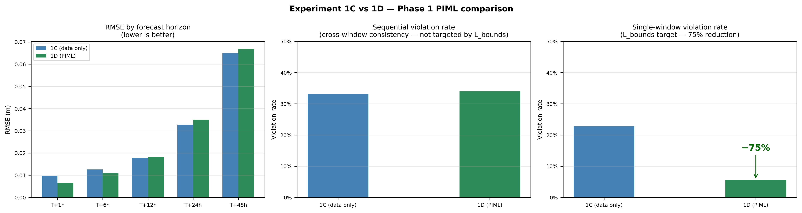

# Beyond Calendar Features: Physics-Constrained LSTM Forecasting of Flood Stage on the River Shannon

**OPW Station 25017 — Banagher Bridge, River Shannon**  
Daniel Burke — AMR Aero

A research implementation of Physics-Informed Machine Learning (PIML) for multi-horizon flood stage forecasting. An LSTM neural network is trained with a composite physics-informed loss function encoding hydraulic constraints derived from the 35-year record at Station 25017.

**What this demonstrates:**
- Encoding domain-specific physical constraints (hydraulic rise rate bounds, recession monotonicity) directly into a neural network loss function
- Empirically deriving physics parameters (P95 rise rate, recession constant K_r) from a 35-year gauge record and using them without hardcoding
- Ablation methodology to isolate the contribution of individual physics terms — showing that L_bounds alone accounts for a 75% reduction in physical violation rate with no degradation in forecast accuracy



---

## Motivation

Standard ML approaches to flood forecasting overfit to seasonal calendar patterns — they learn that "late December at Banagher is typically high" but cannot distinguish a dry January from a flood January. This project replaces calendar features with the recent gauge sequence and embeds hydraulic physics directly into the training objective.

Three physics constraints are encoded in the loss function:

| Loss term | Physics encoded | Derived from |
|---|---|---|
| L_data | MSE on observed water level | — |
| L_bounds | Empirical P95 rise rate ≤ 0.012 m/hr | 35-year record (Cell 3) |
| L_recession | Monotonicity during recession (K_r = 20.1 days) | Exponential decay fits (Cell 4) |

---

## Phase 1 Results

| Experiment | Description | Best val MSE | T+1h RMSE | T+48h RMSE | NSE (T+48h) |
|---|---|---|---|---|---|
| 1C | LSTM, data only | 0.005737 | 0.010 m | 0.065 m | 0.9858 |
| 1D | PIML (L_data + L_bounds + L_recession) | 0.006724 | 0.007 m | 0.067 m | 0.9849 |
| 1D-i | L_bounds only | 0.006025 | 0.006 m | 0.066 m | 0.9854 |
| 1D-ii | L_recession only | 0.006784 | 0.007 m | 0.067 m | 0.9849 |

**Single-window physics violation rate:** 22.8% (1C) → 5.6% (1D) — **75% reduction**

**Ablation finding:** L_bounds is the dominant term — 1D-i (bounds only) achieves 5.29% violation vs 1D-ii (recession only) at 7.59%. RMSE is statistically indistinguishable across all physics experiments (NSE ≥ 0.985 at T+48h). Full methodology and results: [`flood_ml.html`](flood_ml.html)

---

## Repository Structure

```
shannon-flood-piml/
├── flood_analysis_piml.ipynb    # Main PIML notebook — run this
├── water_levels_banagher.ipynb  # Original XGBoost baseline notebook
├── flood_ml.html                # Living research document
├── data/
│   ├── tsvalues.csv             # 15-min gauge record, 1989–2024 (OPW Station 25017)
│   └── 25017_banagher_s_complete.csv  # Daily aggregate record
├── models/
│   ├── lstm_1c_best.pt          # Experiment 1C — data-only LSTM
│   ├── lstm_1d_best.pt          # Experiment 1D — full Phase 1 PIML
│   ├── lstm_1di_best.pt         # Experiment 1D-i — L_bounds only
│   └── lstm_1dii_best.pt        # Experiment 1D-ii — L_recession only
├── history/
│   ├── lstm_1d_history.json
│   ├── lstm_1di_history.json
│   └── lstm_1dii_history.json
├── figures/
│   ├── 1c_learning_curve.png
│   ├── 1c_forecast_flood.png
│   ├── 1c_vs_1d_comparison.png
│   ├── 1c_vs_1d_forecast.png
│   └── recession_case_studies.png
├── DATA_SOURCES.md
├── environment.yml
└── README.md
```

---

## Setup

**Requirements:** Python 3.11, PyTorch (MPS on Apple Silicon or CUDA on Linux/Windows)

```bash
conda env create -f environment.yml
conda activate flood-piml
```

Install PyTorch separately for hardware acceleration:

```bash
# Apple Silicon (MPS)
pip install torch torchvision torchaudio

# CUDA
pip install torch torchvision torchaudio --index-url https://download.pytorch.org/whl/cu121
```

Open `flood_analysis_piml.ipynb` and run cells in order. Saved checkpoints in `models/` are detected automatically — cells skip retraining if a checkpoint and history file both exist.

---

## Data

OPW Station 25017 (Banagher Bridge, River Shannon), National Hydrometric Monitoring Network. Accessed via [waterlevel.ie](https://waterlevel.ie). Licensed under CC BY 4.0.

See [DATA_SOURCES.md](DATA_SOURCES.md) for full attribution, disclaimer, and licence terms.

---

## Research Document

[`flood_ml.html`](flood_ml.html) covers the full methodology: physics derivation, Manning's equation parameterisation, recession constant estimation, loss function design, experimental results, and limitations. Open in a browser.

---

## Related

Live deployment system: [shannon-flood-deploy](https://github.com/burked9/shannon-flood-deploy) *(in development)*

---

## Citation

```
Burke, D. (2026). Beyond Calendar Features: Physics-Constrained LSTM Forecasting
of Flood Stage on the River Shannon. AMR Aero.
https://github.com/burked9/shannon-flood-piml
```
